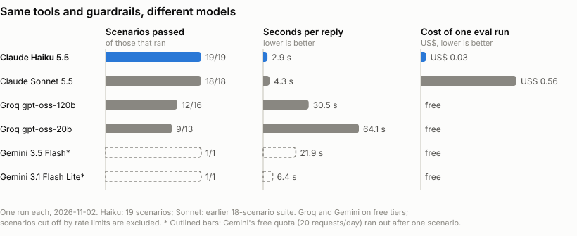

# Empório da Música: customer-service agent

[](https://github.com/rlbuff7/emporio-agent/actions/workflows/tests.yml)

A text-chat agent for Empório da Música, a fictional musical-instrument store in Campo Grande/MS.
It answers customers in Brazilian Portuguese. It looks up products, prices, promotions and orders
in the store's data, applies the store's policy manual, opens a ticket for the human team when a
decision isn't its to make, and turns down anything outside the store's scope.

I built it for the Artefact AI Engineer technical challenge in Python, with the Anthropic SDK called
directly (no agent framework), SQLite and a command-line chat.

An excerpt from [`examples/02_price_promotion_pix.md`](examples/02_price_promotion_pix.md), recorded in the tester view
(`--debug`), so the tool call and its result show up before the reply. A customer sees only the reply;
see [Customer view and tester view](#customer-view-and-tester-view).

```text
Você: Quanto custa o Crafter HT-100? Tem desconto no PIX?
  [tool] get_product({"name_or_id": "Crafter HT-100"})
         -> {"product_id": 90, ..., "original_price_brl": 2399.0, "promotion": {"campaign": "Desconto
            Exclusivo", "discount_percent": 18}, "final_price_brl": 1967.18, "pix_price_brl": null, ...}
Empório da Música: O Crafter HT-100 Folk Aço Natural está em promoção "Desconto Exclusivo":

- Preço original: R$ 2.399,00
- Desconto: 18%
- Preço final: R$ 1.967,18
- Parcelamento: até 12x de R$ 163,93 sem juros

Sobre o PIX: o desconto de 5% não se aplica a produtos que já estão em promoção, então esse não tem
preço especial no PIX. O estoque atual é de 3 unidades.
```

Every number in the reply is in the tool result. `"pix_price_brl": null` is how the code tells the
model there is no PIX discount on a promoted item; the model doesn't decide that.

---

## Quickstart

You need Python 3.11+ and your own Anthropic API key ([console.anthropic.com](https://console.anthropic.com)).
The repository contains no key. A full test conversation costs about US$ 0.01 with the default model.

```bash
git clone https://github.com/rlbuff7/emporio-agent.git
cd emporio-agent
python -m venv .venv
# Windows: .venv\Scripts\activate    macOS/Linux: source .venv/bin/activate
pip install -e ".[dev]"

cp .env.example .env              # then set ANTHROPIC_API_KEY in .env

python -m emporio.etl             # builds data/emporio.db from the CSVs (the chat also does this if missing)
python -m emporio.chat            # the chat as a customer sees it
python -m emporio.chat --debug    # tester view: also prints tool calls, results and guardrail events
pytest                            # 125 offline tests, no API key needed
```

Inside the chat, `/reset` starts a new conversation and `/sair` quits. `--save file.md` writes the
transcript to Markdown on exit, which is how the files in `examples/` were made.

### Customer view and tester view

`python -m emporio.chat` is what a customer would see. While the agent works, a "Empório da Música
está digitando..." line appears, and then the reply is typed out:

```text
Você: Quanto custa o Crafter HT-100? Tem desconto no PIX?
Empório da Música: O Crafter HT-100 Folk Aço Natural está em promoção "Desconto Exclusivo":

- Preço original: R$ 2.399,00
- Desconto: 18%
- Preço final: R$ 1.967,18
- Parcelamento: até 12x de R$ 163,93 sem juros
...
```

`--debug` is only for whoever is testing or reviewing the agent. It adds the lines a customer
never sees: each tool call with its arguments and result, and any guardrail event (an injection
reminder, a rejected reply, a fallback to another provider). The excerpt at the top of this README
and the files in `examples/` were recorded in this mode on purpose, to show where every answer
came from. In a real channel such as WhatsApp, only the customer view would exist.

The typing effect runs after the whole reply has passed the output guardrail. Streaming tokens
straight from the API would show the customer text before that check, so the agent doesn't stream.

If you don't have an Anthropic key, `pytest` and the transcripts in `examples/` need no key at all.
You can also chat with the agent on a free Gemini key ([aistudio.google.com/apikey](https://aistudio.google.com/apikey),
no card): run `pip install -e ".[free]"`, then set `GEMINI_API_KEY` and
`EMPORIO_MODEL=gemini:gemini-3.1-flash-lite` in `.env`. The tools and guardrails are the same, but
the free model is slower and makes more mistakes (see [`docs/model_choice.md`](docs/model_choice.md)).

Other options:

```bash
python evals/run_evals.py                          # 19 live scenarios graded in code (~US$ 0.03 with Haiku)
EMPORIO_MODEL=claude-sonnet-5-5 python -m emporio.chat          # another Anthropic model
EMPORIO_FALLBACK_MODEL=gemini:gemini-3.1-flash-lite,groq:openai/gpt-oss-20b python -m emporio.chat  # Claude, then Gemini, then Groq
```

---

## Architecture

```text
 customer message
        │
        ▼
 ┌──────────────────────┐   too long → polite refusal, model never called
 │ 1. input guardrail   │   injection pattern → one-turn system reminder
 └──────────┬───────────┘
            ▼
 ┌──────────────────────┐   system prompt = persona + hard rules + full policy manual
 │   LLM (Claude Haiku) │◄─────────────── (static, cached across turns)
 └──────────┬───────────┘
   tool_use │  ▲ tool results (JSON)
            ▼  │
 ┌──────────────────────┐   read-only SQLite · identity check in code · lockout after
 │ 2. tools (Python)    │   3 failed verifications · 3 tickets/session · whitelist
 └──────────────────────┘
            │ final text
            ▼
 ┌──────────────────────┐   every "R$" must come from a tool, the customer or the manual;
 │ 3. output guardrail  │   no system-prompt leak → else regenerate once → else safe reply
 └──────────┬───────────┘
            ▼
       reply shown
```

| File | Role |
|---|---|
| `src/emporio/etl.py` | CSVs to SQLite, with typing, NULLs, validated JSON and an `active_promotions` view |
| `src/emporio/tools.py` | The seven tools. All arithmetic lives here: promotion and PIX prices, installments, return and warranty windows, opening hours and holidays |
| `src/emporio/tool_schemas.py` | Tool definitions as the model sees them |
| `src/emporio/prompts.py` | System prompt: persona, rules, how the manual's contradictions were resolved, and the manual itself |
| `src/emporio/agent.py` | The loop. `BaseAgent` holds the provider-independent flow and the guardrails, `Agent` talks to Anthropic, and `FallbackAgent` hands a turn to another provider when Claude is down |
| `src/emporio/guardrails.py` | Input and output checks |
| `src/emporio/compat.py` | Adapter for OpenAI-compatible providers (Gemini, Groq...), used for the model comparison and the fallback |
| `src/emporio/chat.py` | CLI |
| `data/policies.md` | The policy PDF converted to Markdown, word for word |

The tools:

| Tool | Purpose |
|---|---|
| `search_products` | Catalog search with category, price, string-type and pickup filters, sorted by final price |
| `get_product` | One product by name or id, with fuzzy matching, specs, ended promotions, and alternatives when it's unavailable |
| `get_active_promotions` | Original price, discount and final price of each active promotion |
| `get_order_status` | Needs the order number and the e-mail or phone on that order |
| `get_current_datetime` | Time in Campo Grande, open or closed, holiday, next opening |
| `get_opening_hours` | Whether the store opens on a given date, counting weekends and national, state and city holidays |
| `escalate_to_human` | Opens a ticket in `data/handoffs.jsonl` and returns its number |

---

## Technical decisions

<picture>
  <source media="(prefers-color-scheme: dark)" srcset="docs/model_comparison_dark.svg">
  
</picture>

The chart comes from the live eval runs (`python evals/plot_comparison.py` redraws it). The Gemini
bars are outlined because their free quota ran out after one scenario, so they can't be compared
with the others; see [`docs/model_choice.md`](docs/model_choice.md).

| Decision | Choice | Why |
|---|---|---|
| Agent approach | Function calling for data; the whole manual in the system prompt for policies | Prices, stock and orders are tabular and need exact queries. The manual is about 8 pages (~4k tokens), so it fits in context, and retrieval would only add a way to fail (a missed chunk). If the manual grew, I'd move to RAG with one chunk per numbered section. |
| Framework | None, just a small loop on the Anthropic SDK | Everything sent to the model and everything that comes back passes through one place, which makes it easy to read and debug. A framework would hide exactly the parts the challenge is evaluating. |
| Model | `claude-haiku-5-5` | I picked it after running 19 graded scenarios. Haiku 5.5 passed all 19 at 3.1 s per reply and about US$ 0.03 per run. Sonnet 5.5 also passed everything on the earlier 18-scenario suite, but it was slower and cost about 25 times more. The free Groq `gpt-oss` models missed facts customers ask for and took 30 to 64 s per reply under rate limits; Gemini's free quota ran out after one scenario. Details in [`docs/model_choice.md`](docs/model_choice.md). |
| Where numbers come from | Code only | The model never computes a price, discount, installment or deadline. The tools return final values, and the output guardrail rejects any `R$` amount that didn't come from a tool. |
| Database | SQLite built from the CSVs | No infrastructure, real SQL, rebuilt with one command. The tools open it read-only. |
| Interface | CLI | The challenge is about the agent. `--debug` prints every tool call, so you can check where each answer came from. |
| Conversation history | In memory, per session | Multi-turn flows need it, identity verification for example. Persisting it would mean storing personal data, which a prototype gains nothing from. |
| Human handoff | A tool that writes a ticket | The policy spec sorts use cases into AUTO, TRIAGE and HUMAN. The bot never approves or denies a return, exchange, warranty claim or discount. It checks eligibility, collects the data and opens a ticket. |
| Prompt strategy | Static system prompt (persona, rules, resolved contradictions, manual), cached | Static content caches well, so most input tokens are cache reads. Anything that depends on the date or time comes from a tool. |
| Safety | Three layers: input heuristics, tools that enforce the rules in code, output validation | A customer can argue with a prompt rule. Identity and prices are enforced in code, so even a successful injection can't read another customer's order or invent a discount. |
| Availability | Optional fallback chain (`EMPORIO_FALLBACK_MODEL`): Claude, then Gemini Flash Lite, then Groq `gpt-oss-20b` | When Claude returns 429, 5xx or a network error, that turn goes to the next provider in the chain, with the same tools and guardrails. The next turn goes back to Claude. I preferred this to rotating models on every message, which would change the tone mid-conversation and save almost nothing at these prices. |

---

## Data handling

The full report is in [`docs/data_quality.md`](docs/data_quality.md): 15 findings, the decision for
each, and a test pinning every data finding. The ones that shaped the agent most:

- Descriptions contradict names and specs for basses, drums and keyboards. A "Music Man" bass is
  described as a Fender, and an "88-key" description sits on a 61-key spec. The agent goes by name,
  specs and price and doesn't quote those descriptions.
- Promotions have no dates, just an `is_active` flag and a campaign label. It's November, Black
  Friday month, and the Black Friday rows are inactive anyway. The flag wins; the agent never infers
  a discount from the calendar.
- Orders 3 and 20 don't add up at current prices, and `order_items` has no unit price, so the
  recorded total is shown as the amount charged.
- Two customers share an e-mail address. That's why identity is checked per order (order number
  plus that order's e-mail or phone) and never by e-mail alone.
- The manual contradicts itself on the phone number, the e-mail spelling and the installment
  minimums. Each choice is written down and stated in the prompt.

---

## Assumptions

- "Today" is the real date in Campo Grande (UTC-4, no daylight saving).
- Return windows count from receipt, but the data has no receipt date. The agent uses
  `estimated_delivery` as an estimate and asks the customer to confirm it before saying whether a
  window is open.
- National, Mato Grosso do Sul and Campo Grande holidays close the store. Good Friday is computed
  from Easter. Carnival, Corpus Christi and the 24/12 and 31/12 eves are "pontos facultativos" in
  Decreto Municipal 16.469, so the store opens on those days. The two city holidays come from the
  press and the TJMS court calendar; I couldn't find the law that creates them.
- (67) 3341-4444 is the phone and (67) 3321-4500 is the WhatsApp, because section 7 of the manual is
  the one about that channel.
- Installments follow the tiers in section 3.1. I read "no minimum, except below R$ 50" as a R$ 50
  minimum installment for up to 3x. The cheapest product costs R$ 159.90, so this never changes an
  answer.
- Shipping to other cities needs a CEP, weight and dimensions, and the data has none of those. The
  agent opens a quote ticket instead of guessing.
- The customers are Brazilian, so the agent answers in Portuguese. Everything else in the
  repository is in English, as the challenge asks.

---

## Example conversations

All five were generated with the CLI in `--debug` mode, so each one shows the tools the agent
called.

1. [Catalog search with filters](examples/01_catalog_search.md): "violões até R$ 1000", then nylon for a beginner.
2. [Price, promotion and the PIX rule](examples/02_price_promotion_pix.md): the discounts don't stack.
3. [Late order and complaint](examples/03_late_order_complaint.md) (non-trivial): identity check, a
   247-day delay computed in code, a complaint ticket, and the store closed for a holiday.
4. [Return request outside the window](examples/04_return_policy.md) (non-trivial): the policy is
   applied to the real dates, and the bot approves nothing.
5. [Out of scope, store info and prompt injection](examples/05_out_of_scope_and_hours.md).

---

## Testing

There are three levels, and [`docs/testing.md`](docs/testing.md) records what each one found.

1. `pytest` runs 125 offline tests with no key and no network. They cover the ETL, every
   data-quality finding, every tool rule (pricing, PIX, installments, LGPD, lockout, return windows,
   opening hours and the 2026 holiday calendar), the agent loop with scripted fake clients, both
   adapters, the fallback and the guardrails.
2. `evals/run_evals.py` runs 19 live conversations and grades them in code. Eight are functional:
   catalog, promotion and PIX, an expired promotion, a late order, the return window, scope and
   hours, hours on a given date, and a lookup with the wrong e-mail. Eleven are adversarial: a role
   swap, a fake manager, a request for another customer's data, orders looked up by name, e-mail
   brute force, a fake `<system>` tag, a wrong claim about consumer law, a prompt leak, a competitor
   price match, a request to add two prices, and a mixed off-topic question. Results per model are
   in `evals/results/`.
3. I also tested by hand in the CLI. That caught problems the scripts didn't: expired options listed
   as if they were still open, display glitches in the Windows terminal, a date question answered
   with a ticket, and an ambiguous word picked silently. Each one has a fix commit in the testing log.

---

## Known limitations

- 19 scenarios run once each is closer to a smoke test than a benchmark. Model output varies from
  run to run.
- The agent won't add prices together ("os dois juntos dão quanto?"). It lists each price, because
  the output guardrail only allows amounts a tool returned. A `quote_total` tool would solve it.
- Product search matches substrings, so a typo like "Takamini" finds nothing.
- The injection check is a list of patterns, and all it does is add a reminder. The real
  protection is in the tools and the output check.
- Everything runs in one process with in-memory state, and tickets go to a local JSONL file. The
  verification lockout is per session, so restarting the CLI resets it; a real channel would key it
  by phone number.
- There's no real channel: no WhatsApp integration and no out-of-hours queue beyond what the agent
  tells the customer.

## What I'd do with more time

- Pay for the fallback. The free Gemini tier hit its per-minute limit after about 8 requests in
  testing, and a paid tier would make the fallback dependable.
- Grow the eval set, run each scenario several times, add an LLM judge for tone, and run it in CI
  whenever the prompt changes.
- Add a `quote_total` tool for carts and proposals (UC-03 in the spec), with totals, PIX and
  installments computed in code.
- Store conversations and tickets in a real database and connect the WhatsApp Business API, with an
  out-of-hours queue.
- Trace every tool call and guardrail event, with dashboards for handoff rate and failed
  verifications.
- Switch to RAG with one chunk per manual section if the manual grows past what fits comfortably in
  context.
- Payments, which I left out on purpose: a gateway behind an adapter, a PIX code or payment link
  generated by code, an idempotent confirmation webhook, stock deducted only after payment, and
  people involved only in the exceptions.

---

## How I used an AI coding assistant

I used Claude Code as a pair programmer, and the process went like this.

1. Plan first. Before writing any code I prepared a working plan and a business-rules spec that
   maps each section of the manual to a use case with an autonomy level. Both are in Portuguese and
   stay out of the repository. The standing rules live in `CLAUDE.md`: English deliverables,
   Portuguese replies to customers, no framework, numbers computed only in code, one phase at a
   time, small commits.
2. One phase at a time, with my review in between. Claude Code proposed the plan for each phase
   (ETL, tools, agent, guardrails, examples, README). I reviewed it and changed what I disagreed
   with, then let it build and commit. The commit history follows those phases.
3. The calls I made: a CLI rather than a WhatsApp mock, SQLite rather than a database server, a
   guardrail at the start, middle and end of every turn, live adversarial testing, measuring models
   instead of picking one, trying free providers, Haiku as the default, a fallback chain instead of
   model rotation, and testing the smallest model of each provider to save tokens.
4. What the assistant did: it profiled the data and found most of the 15 issues, wrote the code and
   the tests, ran the live scenarios and fixed what they exposed. Some examples: the bot opened a
   ticket on a holiday without saying the store was closed, Gemini 3 needs its `thought_signature`
   sent back, and one injection phrasing slipped past the input check.
5. How I checked its work: I read the diffs, used the CLI myself (my sessions found four of the
   problems in the testing log), read the transcripts, and kept `pytest` green on every commit. I
   also held it to one rule: every claim in these docs had to come from a test or a measurement.
   Before submitting, a software engineer reviewed the project; his suggestions (colors in the CLI,
   closing each reply with a concrete next step) are finding 10 in the testing log.

---

## License

The code, tests, evals and documentation are under the MIT license (see [`LICENSE`](LICENSE)). The
challenge material in `data/raw/` (the store's CSVs and policy manual) and its conversion in
`data/policies.md` were provided by Artefact and are not covered by it.
