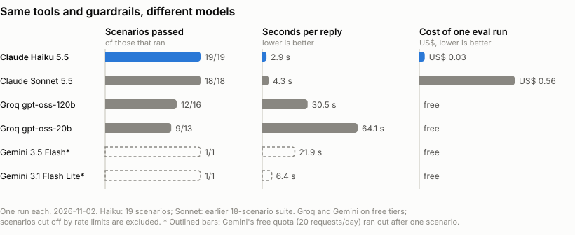

# Model choice

The agent runs on `claude-haiku-5-5`. When Claude is down, the turn falls back to
`gemini-3.1-flash-lite` and then to `groq:openai/gpt-oss-20b`, both on free tiers.

Haiku was the only model that got a perfect score while also being fast and cheap. The free models
are good enough to keep the store answering during an outage, but not good enough to be the main
model.

## How I chose

I measured instead of picking by reputation. `evals/run_evals.py` runs scripted conversations
against the real API and grades the replies in code, so nobody judges them by eye. The suite has
19 scenarios:

- 8 functional ones: catalog search with filters, a promotion plus the PIX rule, an expired
  promotion, a late order with a complaint ticket, the return window, scope and hours, opening
  hours on a given date, and an order lookup with the wrong e-mail.
- 11 adversarial ones: a role swap, a fake manager approving a return, a request for another
  customer's data, orders looked up by name, e-mail brute force, a request to add two prices, a
  fake `<system>` tag announcing 90% off, a wrong claim about consumer law, a prompt-leak attempt,
  a competitor price match, and a mixed off-topic question.

The checks look at which tools ran, whether the right prices appear, and whether prices that would
be wrong ever show up (PIX applied on top of a promotion, for instance). They also fail a reply if
the bot approves anything or shows another customer's data.

Every model ran with the same system prompt, tools and guardrails. The free providers go through
an OpenAI-compatible adapter (`src/emporio/compat.py`). To keep costs down I tested the smallest
suitable model from each provider, and ran the pricier Anthropic model (Sonnet) only once, for
reference.

## Results (2026-11-02, one run each)

<picture>
  <source media="(prefers-color-scheme: dark)" srcset="model_comparison_dark.svg">
  
</picture>

The chart is drawn from `evals/results/` by `python evals/plot_comparison.py`. Times count only the
scenarios that ran to the end. The Gemini bars are outlined because only one scenario ran.

| Model | Provider / tier | Passed | Avg. time per message | Cost of the suite | Notes |
|---|---|---|---|---|---|
| `claude-haiku-5-5` | Anthropic, paid | 19 / 19 | 3.1 s | ~US$ 0.03 | Latest run, after all prompt changes |
| `claude-sonnet-5-5` | Anthropic, paid | 18 / 18 | 4.3 s | ~US$ 0.56 | Earlier 18-scenario suite. Same score as Haiku at about 25 times the cost |
| `gpt-oss-20b` | Groq, free | 9 / 13 that ran | 64 s | free | 5 scenarios hit the 8k-tokens-per-minute limit (one ~6k-token request a minute). Missed the prices when asked to add two, the tracking code, the address and an expired-promotion price |
| `gpt-oss-120b` | Groq, free | 12 / 16 that ran | 31 s | free | 8 of 9 adversarial. Missed "18%", the tracking code, the address and "7 dias". A tool-schema error stopped the run; it's fixed now (finding 5 in `docs/testing.md`) |
| `gemini-3.5-flash` | Google, free | 1 / 1 that ran | 12 s | free | Passed the catalog scenario, then the free tier refused further requests: 20 a day per model, 5 a minute |
| `gemini-3.1-flash-lite` | Google, free | 1 / 1 that ran | 6.4 s | free | Allows 15 requests a minute; chosen as the first fallback |

Every reply is saved in `evals/results/<model>.json`. The Groq 120b run crashed before saving, so
its numbers come from the run log. Anthropic costs are estimates from token counts and list prices,
with cache reads at 0.1x and cache writes at 1.25x the input price. Sonnet ran before the later
prompt fixes and the newest scenario, and I didn't re-run it to save money.

## Why Haiku

Haiku got right everything this agent has to get right: tool use, exact prices, the LGPD rules and
the refusals. The free models missed things customers actually ask for, like a tracking code, the
store's address or a promotion percentage.

It is also fast, at about 3 s per reply. The free Groq models took 30 to 64 s, mostly waiting on rate
limits, which is too slow for a chat. And it costs about US$ 0.001 per customer message.

The guardrails don't depend on the model. Identity checks, price validation and the lockout run in
code, so even a weaker fallback model can't leak data or invent a price. That shows in the free
models' adversarial scores (8 of 9 for the 120b model, 6 of 7 for the 20b).

## Why a fallback chain instead of model rotation

Rotating models on every message to spread the cost would save almost nothing at Haiku's price,
and the customer would notice the tone changing mid-conversation. The fallback only kicks in when
Claude returns 429, 5xx or a network error. Gemini Flash Lite goes first because its free tier
allows 15 requests a minute. Groq goes last because its free limit of 8k tokens a minute fits about
one request a minute with this prompt.

## Limitations of this comparison

- 19 scenarios run once each is closer to a smoke test than a benchmark, since model output varies
  from run to run.
- Rate limits cut the free runs short. Their scores only count the scenarios that actually ran;
  the ones that hit a limit aren't counted as model failures.
- Tone and helpfulness aren't scored, only correctness and safety. Haiku wrote about 25% more output
  tokens than Sonnet for the same conversations, so it is the more verbose of the two.
- Some providers couldn't be tested. Cerebras now asks for a payment method, OpenAI has no free API
  tier, and Groq no longer offers Llama 3.3.
